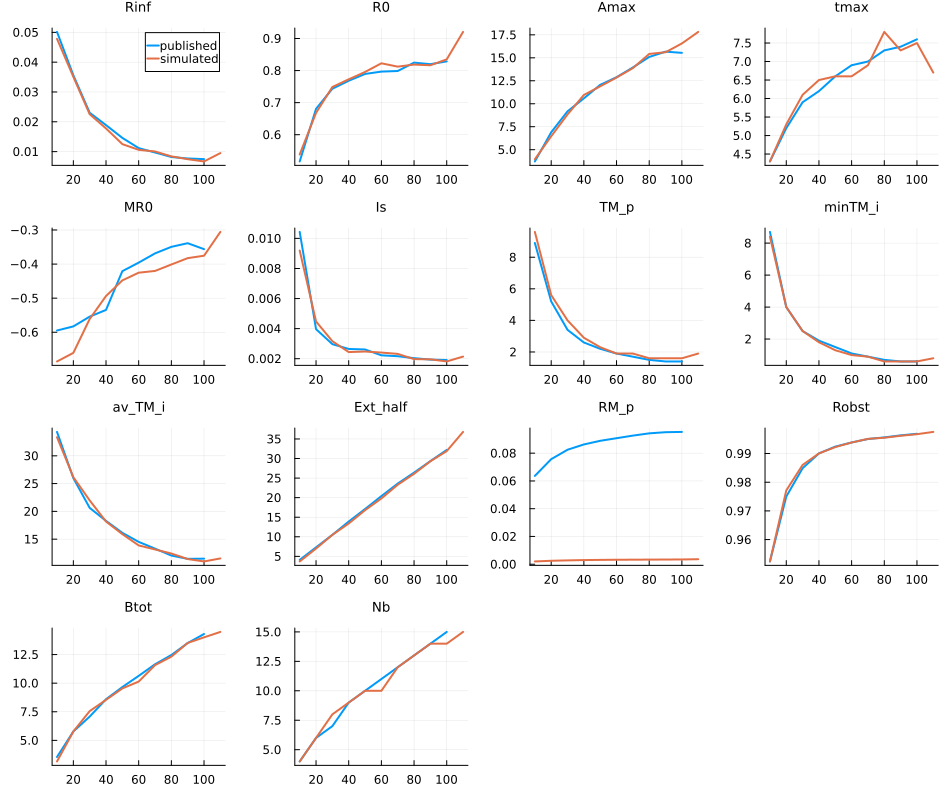
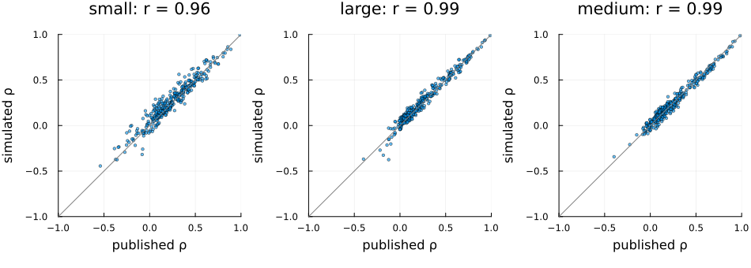

# End to end: a simulated ensemble against the published one
Simon Frost

- [Overview](#overview)
- [The metrics, size by size](#the-metrics-size-by-size)
- [The analysis on simulated
  communities](#the-analysis-on-simulated-communities)
- [How correlations change with
  size](#how-correlations-change-with-size)

## Overview

This vignette closes the loop. It compares an ensemble of communities
simulated with this package (`scripts/simulate_dataset.jl`) with the
authors’ Dataset S1/S2, first metric by metric and then through the
paper’s analysis: correlations by size class, modular groups, and how
correlations change with community size.

``` julia
using DominguezGarcia2019
using CSV, DataFrames, Statistics, Random, Printf
using Plots
data = joinpath(pkgdir(DominguezGarcia2019), "data")
sim_raw = CSV.read(joinpath(data, "simulated", "ensemble_v4.csv"), DataFrame)
pub_raw = CSV.read(joinpath(data, "dominguez-garcia2019", "Dataset_S2.csv"), DataFrame)
(simulated = nrow(sim_raw), published = nrow(pub_raw),
 median_seconds_per_community = median(sim_raw.seconds))
```

    (simulated = 10000, published = 9380, median_seconds_per_community = 6.38)

Each simulated community was drawn with initial richness uniform on
5–110 and its own random seed (`Sim<seed>`), so every row can be
regenerated.

The raw columns follow the published convention (`community_record`,
`convention = :published`). `Amax` and `tmax` come from the ∞-norm of
the propagator, and the four median metrics use the published pulse
weights, which are misaligned after extinctions
(`published_pulse_covariance`). The SI’s versions of these six columns
are kept as `*_si` (see `lab/wiki/analysis/published-conventions.md`).

## The metrics, size by size

``` julia
bins = 5:10:105
binned(df, col) = [let v = df[(df.N .>= b) .& (df.N .< b + 10), col]
                       isempty(v) ? NaN : median(v)        # the published data stop at N = 99
                   end for b in bins]
cols = [:Rinf, :R0, :Amax, :tmax, :MR0, :Is, :TM_p, :minTM_i, :av_TM_i, :Ext_half, :RM_p, :Robst, :Btot, :Nb]
plot([plot(bins .+ 5, binned(pub_raw, c); label = "published", lw = 2, title = string(c), titlefontsize = 9,
           legend = c === :Rinf ? :topright : false) for c in cols]...; layout = (4, 4), size = (950, 800))
for (k, c) in enumerate(cols)
    plot!(bins .+ 5, binned(sim_raw, c); subplot = k, label = "simulated", lw = 2)
end
current()
```



Medians by richness, in the raw columns of the dataset (before the sign
changes of the analysis). The calibration targets were total biomass and
the number of plants. The other panels are independent checks of the
reconstructed simulator.

## The analysis on simulated communities

The published Dataset S2 has 100 communities at each richness. The
10,000 simulated communities give about as many per richness (the median
is printed below), so correlations at a single richness are about as
noisy in both; class averages pool 11 sizes.

``` julia
sim = prepare_metrics(sim_raw)
pub = read_metrics(joinpath(data, "dominguez-garcia2019", "Dataset_S2.csv"))
analysed = 5 .<= sim.N .<= 99
share_varying(v) = 1 - maximum(count(==(x), v) for x in unique(v)) / length(v)
variation = DataFrame(metric = METRICS,
                      simulated = [share_varying(sim[analysed, l]) for l in METRICS],
                      published = [share_varying(pub[!, l]) for l in METRICS])
filter(r -> min(r.simulated, r.published) < 0.5, variation)
```

<div><div style = "float: left;">2×3 DataFrame</div><div style = "clear: both;"></div></div><div class = "data-frame" style = "overflow-x: scroll;">

| Row | metric | simulated | published |
|----:|:-------|----------:|----------:|
|     | String |   Float64 |   Float64 |
|   1 | MAmax  |  0.199507 |  0.221855 |
|   2 | Mtmax  |  0.199507 |  0.221855 |

```@raw html
</div>
```

Only the median maximal amplification and its time take few distinct
values: a median pulse either grows (MAmax \> 1) or the metrics are
exactly `(1, 0)`. The published communities amplify in 22% of cases;
ours do in 1944 of 9744. With the SI’s aligned weights (`MAmax_si`)
almost none do (3), so the two metrics would be constant. The comparison
below uses every metric that varies in at least 1% of communities in
both datasets.

``` julia
labels = filter(r -> min(r.simulated, r.published) >= 0.01, variation).metric
sc_sim = size_correlations(sim; labels, rng = Xoshiro(2019))   # up to 100 communities per richness
sc_pub = size_correlations(pub; labels, rng = Xoshiro(2019))
(metrics = length(labels), sizes = length(sc_sim.sizes), median_per_size = median(sc_sim.n))
```

    (metrics = 27, sizes = 95, median_per_size = 100.0)

``` julia
upper(R) = [R[i, j] for j in axes(R, 2) for i in axes(R, 1) if i < j]
plots = map(SIZE_CLASSES) do (name, (lo, hi))
    Rs, _ = class_average(sc_sim, lo, hi)
    Rp, _ = class_average(sc_pub, lo, hi)
    x, y = upper(Rp), upper(Rs)
    scatter(x, y; ms = 2, alpha = 0.6, label = false, xlabel = "published ρ", ylabel = "simulated ρ",
            title = @sprintf("%s: r = %.2f", name, cor(x, y)), xlim = (-1, 1), ylim = (-1, 1), aspect_ratio = 1)
    plot!([-1, 1], [-1, 1]; label = false, color = :grey)
end
plot(plots...; layout = (1, 3), size = (950, 340))
```



Each point is one of the 300 pairs of metrics: its mean correlation in a
size class in the published data against the simulated data. Points on
the diagonal mean the simulator reproduces that relationship.

``` julia
function groups_table(sc, lo, hi)
    R, _ = class_average(sc, lo, hi)
    g, Q = modular_groups(metric_network(R); runs = 50, rng = Xoshiro(1))
    return g, Q
end
rand_index(a, b) = mean((a[i] == a[j]) == (b[i] == b[j]) for i in eachindex(a) for j in eachindex(a) if i < j)
for (name, (lo, hi)) in SIZE_CLASSES
    gs, Qs = groups_table(sc_sim, lo, hi)
    gp, Qp = groups_table(sc_pub, lo, hi)
    @printf("%-6s Q simulated %.3f, published %.3f; Rand index of the partitions %.2f\n", name, Qs, Qp,
            rand_index(gs, gp))
    foreach(k -> println("   ", join(sc_sim.labels[gs .== k], " ")), 1:maximum(gs))
end
```

    small  Q simulated 0.135, published 0.147; Rand index of the partitions 0.97
       R0 Is Amax tmax Rinf MRinf S <s_ij> TM <TM> minTM <CE> TE maxCE
       MR0 RM <RM> maxRM SM <SM> maxSM <RE> maxRE <SE> maxSE
       MAmax Mtmax
    large  Q simulated 0.187, published 0.207; Rand index of the partitions 1.00
       R0 Amax tmax MR0 MAmax Mtmax
       Is Rinf MRinf S <s_ij> TM <TM> minTM <CE> TE maxCE
       RM <RM> maxRM SM <SM> maxSM <RE> maxRE <SE> maxSE
    medium Q simulated 0.178, published 0.177; Rand index of the partitions 0.88
       R0 Amax tmax MR0 MAmax Mtmax
       Is Rinf MRinf S <s_ij> TM <TM> minTM <CE> TE maxCE
       RM <RM> maxRM SM <SM> maxSM <RE> maxRE <SE> maxSE

The Rand index is the share of pairs of metrics on which the two
partitions agree (together in both, or apart in both).

## How correlations change with size

``` julia
t_sim = combine(groupby(correlation_types(sc_sim), :type), nrow => :simulated)
t_pub = combine(groupby(correlation_types(sc_pub), :type), nrow => :published)
sort(outerjoin(t_pub, t_sim; on = :type), :type)
```

<div><div style = "float: left;">7×3 DataFrame</div><div style = "clear: both;"></div></div><div class = "data-frame" style = "overflow-x: scroll;">

| Row | type   | published | simulated |
|----:|:-------|----------:|----------:|
|     | String |    Int64? |    Int64? |
|   1 | A      |         7 |         2 |
|   2 | B      |         8 |        19 |
|   3 | C      |         7 |         3 |
|   4 | D      |         5 |         5 |
|   5 | E      |        64 |        48 |
|   6 | F      |       105 |       102 |
|   7 | G      |       155 |       172 |

```@raw html
</div>
```

The classes are those of SI §1, Fig. S1: G unchanged; E and F strengthen
or weaken from small to medium communities, then stay constant; B and C
keep strengthening or weakening; A and D change sign.
