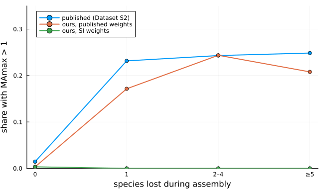

# The early response to pulse: median metrics and an indexing artefact
Simon Frost

- [Overview](#overview)
- [Median metrics and their pulse
  weights](#median-metrics-and-their-pulse-weights)
- [Evidence from the published data
  alone](#evidence-from-the-published-data-alone)
- [The same communities, computed both
  ways](#the-same-communities-computed-both-ways)
- [What this does to the stability
  dimensions](#what-this-does-to-the-stability-dimensions)
- [Caveats](#caveats)

## Overview

Domínguez-García et al. (2019) group 27 stability metrics into three
“dimensions” of stability. One of them, the *early response to pulse*,
is built around three median metrics:

- the median reactivity MR0;
- the median maximal amplification MAmax;
- the time at which it is reached, Mtmax.

This vignette shows that MAmax and Mtmax vary between communities, and
so can form a group at all, only because of a bookkeeping error in how
the median metrics were weighted. The evidence comes first from the
published data alone and then from simulations computed both ways.

``` julia
using DominguezGarcia2019
using FoodWebDynamics
using CSV, DataFrames, Statistics, Random, Printf
using Plots
data = joinpath(pkgdir(DominguezGarcia2019), "data")
pub = CSV.read(joinpath(data, "dominguez-garcia2019", "Dataset_S2.csv"), DataFrame)
sim = CSV.read(joinpath(data, "simulated", "ensemble_v4.csv"), DataFrame)
sim = sim[5 .<= sim.N .<= 99, :]
(published = nrow(pub), simulated = nrow(sim))
```

    (published = 9380, simulated = 9744)

## Median metrics and their pulse weights

The median metrics average the response of the linearised dynamics, with
Jacobian J, over random pulses whose covariance is C (Arnoldi et
al. 2018). The SI follows that paper and takes each species’ pulse
proportional to its equilibrium biomass, C = diag(B²). The median
reactivity is then

$$MR_0 = \frac{\operatorname{Tr}(C J)}{\operatorname{Tr} C}.$$

The published values are reproduced by a different C (see the package
documentation of `published_pulse_covariance`). It takes the biomass
vector over *all initial species* (extinct ones at zero, species in
niche order), truncates it to its first N entries, and uses those as the
weights of the N survivors. When no species died during assembly the two
coincide. After an extinction, survivors receive other species’
biomasses, or zeros.

``` julia
function community_with_losses(rng, S, minlost)    # first viable draw that lost species
    while true
        c, _ = assemble_community(rng, S)
        c !== nothing && c.initial_richness - richness(c) ≥ minlost && return c
    end
end
c = community_with_losses(Xoshiro(7), 30, 3)
op = community_jacobian(c)
N = richness(c)
weights = DataFrame(species = findall(c.model.alive), own_biomass = biomass(c),
                    published_weight = c.B[1:N])
filter(r -> r.own_biomass != r.published_weight, weights)   # survivors whose weight is wrong
```

    ┌ Warning: Verbosity toggle: max_iters 
    │  Interrupted. Larger maxiters is needed. If you are using an integrator for non-stiff ODEs or an automatic switching algorithm (the default), you may want to consider using a method for stiff equations. See the solver pages for more details (e.g. https://docs.sciml.ai/DiffEqDocs/stable/solvers/ode_solve/#Stiff-Problems).
    └ @ DiffEqBase ~/.julia/packages/DiffEqBase/WgyOh/src/check_error.jl:44
    ┌ Warning: Verbosity toggle: max_iters 
    │  Interrupted. Larger maxiters is needed. If you are using an integrator for non-stiff ODEs or an automatic switching algorithm (the default), you may want to consider using a method for stiff equations. See the solver pages for more details (e.g. https://docs.sciml.ai/DiffEqDocs/stable/solvers/ode_solve/#Stiff-Problems).
    └ @ DiffEqBase ~/.julia/packages/DiffEqBase/WgyOh/src/check_error.jl:44

<div><div style = "float: left;">11×3 DataFrame</div><div style = "clear: both;"></div></div><div class = "data-frame" style = "overflow-x: scroll;">

| Row | species | own_biomass | published_weight |
|----:|--------:|------------:|-----------------:|
|     |   Int64 |     Float64 |          Float64 |
|   1 |      18 |     0.58296 |              0.0 |
|   2 |      19 |  0.00468883 |          0.58296 |
|   3 |      20 |  0.00192724 |       0.00468883 |
|   4 |      21 |    0.583215 |       0.00192724 |
|   5 |      22 |  0.00282098 |         0.583215 |
|   6 |      23 |  0.00527902 |       0.00282098 |
|   7 |      24 |  0.00282447 |       0.00527902 |
|   8 |      25 |   0.0105302 |       0.00282447 |
|   9 |      26 | 0.000426869 |        0.0105302 |
|  10 |      27 |  0.00205099 |      0.000426869 |
|  11 |      30 |     1.60977 |       0.00205099 |

```@raw html
</div>
```

``` julia
(species_lost = c.initial_richness - N,
 MR0_si = median_reactivity(op, pulse_covariance(biomass(c))),
 MR0_published = median_reactivity(op, published_pulse_covariance(c)))
```

    (species_lost = 3, MR0_si = -0.5279977995913107, MR0_published = -0.7077880130814678)

## Evidence from the published data alone

Communities that lost no species during assembly are unaffected by the
misalignment. If median amplification were a property of the
communities, it would vary smoothly with how many species they lost.
Instead it switches on at the first extinction.

``` julia
lost_class(l) = l == 0 ? "0" : l == 1 ? "1" : l ≤ 4 ? "2–4" : "≥5"
by_lost(df) = combine(groupby(transform(df, [:iniN, :N] => ByRow((i, n) -> lost_class(i - n)) => :lost), :lost),
                      nrow => :communities, :MAmax => (x -> mean(x .> 1 + 1e-12)) => :share_amplifying,
                      :MR0 => median => :median_MR0)
sort(by_lost(pub), :lost)
```

<div><div style = "float: left;">4×4 DataFrame</div><div style = "clear: both;"></div></div><div class = "data-frame" style = "overflow-x: scroll;">

| Row | lost   | communities | share_amplifying | median_MR0 |
|----:|:-------|------------:|-----------------:|-----------:|
|     | String |       Int64 |          Float64 |    Float64 |
|   1 | 0      |         899 |        0.0144605 |  -0.744172 |
|   2 | 1      |        1287 |         0.231546 |  -0.525975 |
|   3 | 2–4    |        3144 |         0.243003 |  -0.449234 |
|   4 | ≥5     |        4050 |         0.248395 |  -0.340803 |

```@raw html
</div>
```

In Dataset S2, communities that lost no species almost never amplify a
median pulse. With one or more extinctions, about a quarter do,
regardless of how many species were lost. The median reactivity jumps in
the same way.

## The same communities, computed both ways

Our ensemble stores every community’s median metrics under both
weightings. The raw columns follow the published convention; the `*_si`
columns follow the SI.

``` julia
si = copy(sim)
for col in (:Amax, :tmax, :MRinf, :MR0, :MAmax, :Mtmax)
    si[!, col] = si[!, Symbol(col, "_si")]
end
lost = sim.iniN .- sim.N
classes = ["0", "1", "2–4", "≥5"]
share(df) = [mean(df.MAmax[lost_class.(df.iniN .- df.N) .== k] .> 1 + 1e-12) for k in classes]
plot(classes, [share(pub), share(sim), share(si)]; marker = :circle, lw = 2,
     label = ["published (Dataset S2)" "ours, published weights" "ours, SI weights"],
     xlabel = "species lost during assembly", ylabel = "share with MAmax > 1", ylim = (0, 0.35),
     legend = :topleft, size = (650, 380))
```



With the published weighting, our simulations reproduce the switch. With
the SI’s weighting, the number of communities amplifying a median pulse
falls to 3 out of 9744, so MAmax and Mtmax are effectively constant.

## What this does to the stability dimensions

The paper’s groups come from Louvain modularity on the network of
metrics, whose edge weights are the absolute Spearman correlations
averaged over a size class. A constant metric has no defined
correlations, so it cannot belong to any group.

``` julia
sc = Dict("published" => size_correlations(read_metrics(joinpath(data, "dominguez-garcia2019", "Dataset_S2.csv"))),
          "ours, published weights" => size_correlations(prepare_metrics(sim)),
          "ours, SI weights" => size_correlations(prepare_metrics(si)))
function groups(s, lo, hi)
    R, _ = class_average(s, lo, hi)
    g, _ = modular_groups(metric_network(R); runs = 50, rng = Xoshiro(1))
    return [join(s.labels[g .== k], " ") for k in 1:maximum(g)]
end
for name in ("published", "ours, published weights", "ours, SI weights")
    println(name)
    foreach(x -> println("    ", x), groups(sc[name], 85, 95))
end
```

    published
        R0 Amax tmax MR0 MAmax Mtmax
        Is Rinf MRinf S <s_ij> TM <TM> minTM <CE> TE maxCE
        RM <RM> maxRM SM <SM> maxSM <RE> maxRE <SE> maxSE
    ours, published weights
        R0 Amax tmax MR0 MAmax Mtmax
        Is Rinf MRinf S <s_ij> TM <TM> minTM <CE> TE maxCE
        RM <RM> maxRM SM <SM> maxSM <RE> maxRE <SE> maxSE
    ours, SI weights
        R0 Amax tmax
        Is Rinf MRinf S <s_ij> TM <TM> minTM <CE> TE maxCE
        MR0 RM <RM> maxRM SM <SM> maxSM <RE> maxRE <SE> maxSE
        MAmax
        Mtmax

In large communities (85–95 species) the published data and our
simulations with the published weights give the same three groups. The
early-response group holds R0, Amax, tmax, MR0, MAmax and Mtmax. With
the SI’s weights, MAmax and Mtmax are isolated, and MR0 joins the
sensitivities to press. Of the paper’s three dimensions, *distance to
threshold* and *sensitivity to press* survive the correction. The *early
response to pulse* reduces to the extremal pulse metrics R0, Amax and
tmax.

## Caveats

- **The mechanism is inferred.** The authors’ simulation code is not
  public. The truncation reproduces the published distributions and
  their dependence on species lost, but it is inferred from the data,
  not read from their code.
- **The published evidence needs no simulator.** The switch at the first
  extinction comes from the published data alone. Only the comparison of
  groups under the SI’s weighting depends on our reconstruction.
- **Why median pulses rarely amplify here.** In these communities,
  median pulses scaled by biomass are dominated by plants. Plants hold
  most of the biomass and regulate themselves strongly, so median
  amplification is rare under the SI’s definition. This is a property of
  the model family, not a general statement about median amplification.
