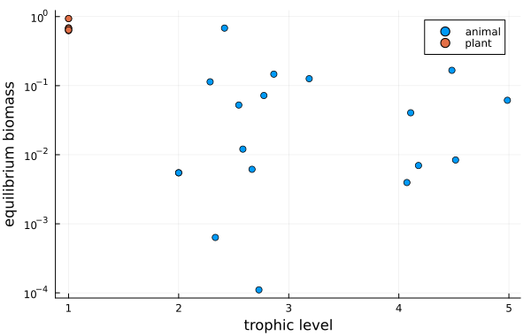
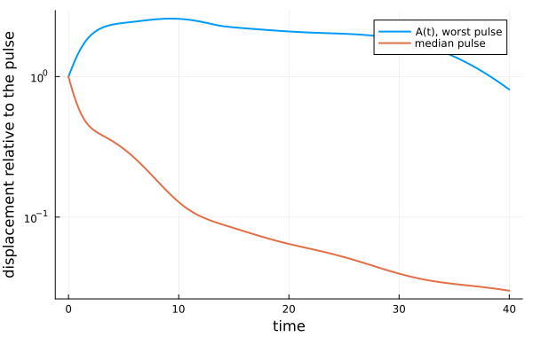
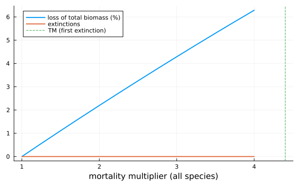

# One food web and its 27 stability metrics
Simon Frost

- [Overview](#overview)
- [A niche-model web](#a-niche-model-web)
- [Assembly](#assembly)
- [Responses to small pulses, from the
  Jacobian](#responses-to-small-pulses-from-the-jacobian)
- [Responses to presses and extinctions, by
  simulation](#responses-to-presses-and-extinctions-by-simulation)

## Overview

The authors’ simulation code is not public, so this package rebuilds it
from SI §8–9 of Domínguez-García et al. (2019). The published dataset is
used to settle what the text leaves open or gets wrong (see the project
wiki: *Simulator reconstruction* and *Calibration*). This vignette
follows one community through the whole procedure:

1.  draw a niche-model web;
2.  run the bioenergetic model to a steady state;
3.  compute the 27 metrics, from the Jacobian and from simulated presses
    and extinctions.

``` julia
using EcologicalResilience
using DataFrames, Statistics, Random, Printf
using Plots
```

## A niche-model web

The niche model of Williams & Martinez (2000) places species on a niche
axis and lets each eat the species within a range below it. The
connectance is 0.15, as in the paper.

``` julia
rng = Xoshiro(42)
web = niche_model(rng, 30, 0.15)
L = trophic_levels(web)
(species = richness(web), connectance = round(connectance(web); digits = 3), basal = count(isbasal(web)),
 max_trophic_level = L === nothing ? missing : round(maximum(L); digits = 2))
```

    (species = 30, connectance = 0.154, basal = 4, max_trophic_level = missing)

## Assembly

`assemble_community` draws a web and the community’s allometric
exponents, starts from random biomasses and integrates to a steady
state. Species are removed when they fall below 10⁻⁶ of their body mass.
The web is discarded if more than 10% of its species die, and plants
left without consumers are then removed. Most draws are discarded. The
`status` records why.

``` julia
attempts = Symbol[]
c = nothing
while c === nothing
    global c, status = assemble_community(rng, 30)
    push!(attempts, status)
end
(attempts = attempts, initial = c.initial_richness, final = richness(c))
```

    (attempts = [:ok], initial = 30, final = 27)

``` julia
B = biomass(c)
alive = findall(c.model.alive)
scatter(c.model.trophic_level[alive], B; yscale = :log10, group = ifelse.(c.model.basal[alive], "plant", "animal"),
        xlabel = "trophic level", ylabel = "equilibrium biomass", size = (600, 380))
```



Without the metabolic loss that SI §8 lists for them, plants sit close
to their carrying capacity of 1. Only this choice reproduces the
dataset’s total biomass per plant (0.98).

## Responses to small pulses, from the Jacobian

The Jacobian at equilibrium gives resilience (the slowest return rate)
and reactivity (the fastest initial amplification). The amplification
envelope A(t) = ‖exp(Jt)‖ is the largest displacement at time t of any
unit pulse. The “median” versions average over pulses proportional to
equilibrium biomass (Arnoldi et al. 2018).

``` julia
J = jacobian(c.B, c.model)
C = pulse_covariance(B)
ts = 0:0.1:40
plot(ts, [amplification_envelope(J, t) for t in ts]; label = "A(t), worst pulse", lw = 2, yscale = :log10,
     xlabel = "time", ylabel = "displacement relative to the pulse", size = (600, 380))
plot!(ts, [median_displacement(J, C, t) for t in ts]; label = "median pulse", lw = 2)
```



``` julia
Amax, tmax = max_amplification(J)
(resilience = resilience(J), reactivity = reactivity(J), Amax = Amax, tmax = tmax,
 median_reactivity = median_reactivity(J, C), stochastic_invariability = stochastic_invariability(J),
 sensitivity = press_sensitivity(J))
```

    (resilience = 0.027373151276825505, reactivity = 0.4707792320817974, Amax = 2.5862447957697587, tmax = 9.3, median_reactivity = -0.6753929845020011, stochastic_invariability = 0.004499060622894939, sensitivity = 340.9024950559039)

The equilibrium is reactive: some pulses grow by a factor of `Amax`
before they decay. A pulse spread over species in proportion to their
biomass decays from the start.

## Responses to presses and extinctions, by simulation

Tolerance to mortality is the smallest increase in mortality that causes
an extinction. It is measured for all species at once (global) and for
each species alone (local). Raising every species’ mortality by 10% and
removing species one at a time give the resistance and sensitivity
metrics.

``` julia
factors = 1.0:0.25:4
resp = [press_response(c, (m, _) -> set_mortality!(m, f)) for f in factors]
plot(factors, [100 * r[1] for r in resp]; lw = 2, label = "loss of total biomass (%)",
     xlabel = "mortality multiplier (all species)", size = (600, 380))
plot!(factors, [r[3] for r in resp]; lw = 2, label = "extinctions", seriestype = :steppost)
vline!([global_mortality_tolerance(c)]; label = "TM (first extinction)", ls = :dash)
```



`community_record` runs every experiment and returns the 39 raw columns
of the authors’ Dataset S1. `prepare_metrics` then turns them into the
27 metrics, each signed so that larger means more stable.

``` julia
rec = community_record(rng, c)
m = prepare_metrics(DataFrame([rec]))
DataFrame(metric = METRICS, value = [m[1, k] for k in METRICS])
```

<div><div style = "float: left;"><span>27×2 DataFrame</span></div><div style = "float: right; font-style: italic;"><span>2 rows omitted</span></div><div style = "clear: both;"></div></div><div class = "data-frame" style = "overflow-x: scroll;">

| Row | metric   |        value |
|----:|:---------|-------------:|
|     | String   |      Float64 |
|   1 | R0       |    -0.470779 |
|   2 | Is       |   0.00449906 |
|   3 | Amax     |     -5.57401 |
|   4 | tmax     |         -6.8 |
|   5 | Rinf     |    0.0273732 |
|   6 | MR0      |     0.675282 |
|   7 | MAmax    |         -1.0 |
|   8 | Mtmax    |         -0.0 |
|   9 | MRinf    |    0.0368317 |
|  10 | S        |     -340.902 |
|  11 | \<s_ij\> |     -1.64206 |
|  12 | TM       |        4.401 |
|  13 | \<TM\>   |      24.6333 |
|   ⋮ | ⋮        |            ⋮ |
|  16 | TE       |     0.403704 |
|  17 | maxCE    |     -7.26923 |
|  18 | RM       |  -0.00224119 |
|  19 | \<RM\>   |  -8.32026e-5 |
|  20 | maxRM    |  -0.00079769 |
|  21 | SM       |   -0.0062326 |
|  22 | \<SM\>   | -0.000675949 |
|  23 | maxSM    |  -0.00488788 |
|  24 | \<RE\>   |   -0.0403705 |
|  25 | maxRE    |    -0.157127 |
|  26 | \<SE\>   |    -0.102798 |
|  27 | maxSE    |    -0.459017 |

</div>
