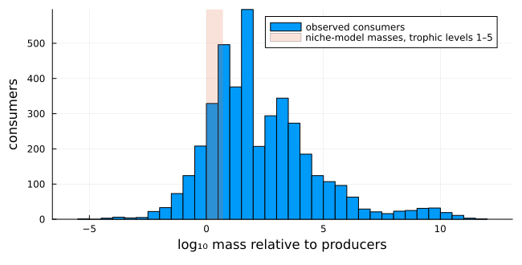

# Observed food webs: the 27 metrics on GATEWAy topologies
Simon Frost

- [Overview](#overview)
- [The data](#the-data)
- [Taxa must be merged into trophic
  species](#taxa-must-be-merged-into-trophic-species)
- [Measured body masses starve the
  consumers](#measured-body-masses-starve-the-consumers)
- [The observed webs under the bioenergetic
  model](#the-observed-webs-under-the-bioenergetic-model)
- [Metric values: observed against niche-model
  webs](#metric-values-observed-against-niche-model-webs)
- [Correlation structure](#correlation-structure)
- [Caveats](#caveats)
- [References](#references)

## Overview

The stability dimensions of Domínguez-García et al. (2019) come from
niche-model food webs. A common criticism is that correlations among
metrics then describe that ensemble of webs, not real communities. This
vignette swaps the network: the same bioenergetic dynamics and the same
27 metrics run on observed topologies from GATEWAy v1.0 (Brose et
al. 2019).

- **The data:** 290 observed webs with binary feeding links and body
  masses, downloaded when the vignette is rendered.
- **Two preparations are needed:**
  - taxa with identical prey and predators must be merged into trophic
    species;
  - the model’s own masses must replace the measured ones.

  Each is shown before it is used.
- **The comparison:** metric values and the correlation structure of
  observed webs against the niche-model ensemble of the
  [simulated-ensemble
  vignette](../03_simulated_ensemble/03_simulated_ensemble.md), judged
  against the noise from splitting the observed webs in half.

``` julia
using DominguezGarcia2019
using FoodWebDynamics
using CSV, DataFrames, Statistics, Random, Printf
using Plots
using Downloads, SHA, p7zip_jll
using LinearAlgebra: BLAS
BLAS.set_num_threads(1)       # Julia threads run the webs; BLAS threads would oversubscribe
data = joinpath(pkgdir(DominguezGarcia2019), "data")
```

## The data

GATEWAy v1.0 is published by iDiv under CC BY 4.0
(doi:10.25829/IDIV.283-3-756). It is too large to ship with the package
(a 96 MB table), so it is downloaded once and cached.

- **Where:** `~/.cache/DominguezGarcia2019/gateway`, or the directory in
  `ENV["GATEWAY_CACHE"]`. To use a copy you already have, set
  `ENV["GATEWAY_CSV"]` to its path.
- **Check:** the table’s SHA-256 is verified. The zip itself is rebuilt
  by the server on each request, so its checksum changes and is not
  checked.
- **Offline:** the vignette stops with a message saying how to supply
  the file.

``` julia
const GATEWAY_URL = "https://idata.idiv.de/ddm/Data/DownloadZip/283?version=756"
const GATEWAY_FILE = "283_2_FoodWebDataBase_2018_12_10.csv"
const GATEWAY_SHA256 = "0862d9f94bd144cb33a635e905bfab186236b122a773236d2521970bf2e9032f"

function gateway_csv()
    path = get(ENV, "GATEWAY_CSV", "")
    if isempty(path)
        root = get(ENV, "XDG_CACHE_HOME", joinpath(homedir(), ".cache"))
        cache = get(ENV, "GATEWAY_CACHE", joinpath(root, "DominguezGarcia2019", "gateway"))
        path = joinpath(cache, GATEWAY_FILE)
        if !isfile(path)
            mkpath(cache)
            zip = joinpath(cache, "gateway.zip")
            # the server assembles the zip on request and sends nothing for about 30 s
            dl = Downloads.Downloader()
            dl.easy_hook = (easy, _) -> Downloads.Curl.setopt(easy, Downloads.Curl.CURLOPT_LOW_SPEED_TIME, 300)
            try
                Downloads.download(GATEWAY_URL, zip; downloader = dl, timeout = 900)
            catch err
                error("Could not download GATEWAy from $GATEWAY_URL: ", first(sprint(showerror, err), 200),
                      "\nDownload it by hand, extract $GATEWAY_FILE and set ENV[\"GATEWAY_CSV\"] to its path.")
            end
            run(`$(p7zip_jll.p7zip()) e $zip $GATEWAY_FILE -o$cache -y -bso0 -bsp0`)
            rm(zip)
        end
    end
    h = bytes2hex(open(sha256, path))
    h == GATEWAY_SHA256 || error("$path has SHA-256 $h, not that of the GATEWAy v1.0 link table")
    return path
end
```

`read_gateway` (from FoodWebDynamics) builds one web per `foodweb.name`.
It strips names, drops exact duplicate links, takes a node’s mass as the
geometric mean over its links (masses are recorded per link and life
stage) and keeps detritus and other non-living resources as basal nodes.

``` julia
taxa_webs = read_gateway(gateway_csv())
combine(groupby(DataFrame(ecosystem = [w.ecosystem for w in taxa_webs],
                          taxa = [richness(w.web) for w in taxa_webs],
                          nonliving = [count(.!w.living) for w in taxa_webs]), :ecosystem),
        nrow => :webs, :taxa => median => :median_taxa, :nonliving => (x -> mean(x .> 0)) => :share_with_detritus)
```

<div><div style = "float: left;"><span>5×4 DataFrame</span></div><div style = "clear: both;"></div></div><div class = "data-frame" style = "overflow-x: scroll;">

| Row | ecosystem               |  webs | median_taxa | share_with_detritus |
|----:|:------------------------|------:|------------:|--------------------:|
|     | String                  | Int64 |     Float64 |             Float64 |
|   1 | terrestrial aboveground |    21 |        97.0 |            0.285714 |
|   2 | marine                  |   134 |        28.0 |           0.0447761 |
|   3 | terrestrial belowground |    52 |       122.5 |            0.942308 |
|   4 | lakes                   |    55 |        37.0 |            0.781818 |
|   5 | streams                 |    28 |        83.5 |            0.821429 |

</div>

## Taxa must be merged into trophic species

In the bioenergetic model a species’ parameters follow from its links
and trophic level. Two taxa with the same prey and the same predators
are therefore identical. If both survive, the community can shift
biomass from one to the other at no cost: the Jacobian has an eigenvalue
0, resilience is 0, and the sensitivity and variance metrics diverge. An
earlier run on the published nodes found this in over a quarter of the
converged communities.

`trophic_species` merges such taxa, repeating until no two nodes share
both sets. This is also the unit Williams & Martinez (2000) used to
compare the niche model with observed webs.

``` julia
webs = trophic_species.(taxa_webs)
kept = [richness(t.web) / richness(w.web) for (t, w) in zip(webs, taxa_webs)]
usable = [k for (k, w) in enumerate(webs) if richness(w.web) ≤ 120 && trophic_levels(w.web) !== nothing]
(webs_with_redundant_taxa = mean(kept .< 1), median_share_of_nodes_kept = median(kept),
 usable_webs = length(usable))
```

    (webs_with_redundant_taxa = 0.993103448275862, median_share_of_nodes_kept = 0.6909814323607427, usable_webs = 259)

- **Redundancy is the rule.** Almost every web has taxa with identical
  links, and aggregation keeps about two thirds of the nodes.
- **Usable webs** have at most 120 trophic species (the largest
  niche-model webs have 110 initial species) and defined trophic levels
  (a web whose consumers form a closed loop with no path to a basal node
  has none).

## Measured body masses starve the consumers

GATEWAy records body masses, so the obvious choice is to use them. Under
the paper’s rate scalings that fails:

- the attack rate scales as aᵢⱼ ∝ mᵢ^0.7 and the handling time as hᵢⱼ ∝
  mᵢ^−0.6 mⱼ^0.5;
- a consumer’s maximum intake per unit biomass is about 1/(hᵢⱼ mᵢ) ∝
  mᵢ^−0.4 mⱼ^−0.5;
- its metabolic loss scales as mᵢ^−0.25.

So intake falls behind metabolism as mass grows. In niche-model webs
masses are Z^(L−1) with Z = 1.5, a few units at most, and the gap is
small. Observed consumers are far heavier relative to their producers.
Below, each consumer’s mass is divided by the geometric mean mass of its
web’s living producers (`relative_masses`), over the usable webs that
record a mass for every consumer.

``` julia
ratios = reduce(vcat, [m[.!isbasal(webs[k].web)] for k in usable for m in (relative_masses(webs[k]),) if m !== nothing])
q = quantile(ratios, [0.1, 0.5, 0.9])
sci(x) = (e = floor(Int, log10(x)); string(round(Int, x / 10.0^e), "×10", map(c -> "⁰¹²³⁴⁵⁶⁷⁸⁹"[nextind("⁰¹²³⁴⁵⁶⁷⁸⁹", 0, c - '0' + 1)], string(e))))
@printf("consumer mass / producer mass over %d consumers: 10%% %.3g, median %.3g, 90%% %.3g\n", length(ratios), q...)
histogram(log10.(ratios); bins = 60, label = "observed consumers", xlabel = "log₁₀ mass relative to producers",
          ylabel = "consumers", size = (650, 330))
vspan!([0, log10(1.5^4)]; alpha = 0.2, label = "niche-model masses, trophic levels 1–5")
```

    consumer mass / producer mass over 4180 consumers: 10% 0.757, median 66.2, 90% 2.07e+05



The median consumer is 66 times heavier than its producers, and one in
ten is more than 2×10⁵ times heavier. Niche-model masses stay below 1.5⁴
≈ 5.

A pilot makes the point dynamically. Webs of up to 40 trophic species
with a mass for every consumer are run once with measured masses and
once with the model’s masses, with the same draw of exponents and
initial biomasses.

``` julia
const PARAMS = BioenergeticParameters()
const EMPTY = NamedTuple{Tuple(RAW_COLUMNS)}(ntuple(_ -> NaN, length(RAW_COLUMNS)))

# Surviving top consumers with the same surviving prey and the same mass are exactly neutral even
# after aggregation (extinctions can remove the links that told them apart). Merging them into one
# species with their summed biomass is exact, because their growth is linear in their own biomass.
# (As in scripts/observed_webs.jl.)
function merge_neutral!(model, B)
    A, alive = model.web.A, model.alive
    top = [i for i in findall(alive) if !model.basal[i] && !any(alive[k] && A[k, i] for k in eachindex(alive))]
    merged = 0
    for (a, i) in enumerate(top), j in top[(a + 1):end]
        (alive[i] && alive[j] && model.mass[i] == model.mass[j]) || continue
        if all(A[i, k] == A[j, k] for k in eachindex(alive) if alive[k])
            B[i] += B[j]
            kill!(model, B, j)
            merged += 1
        end
    end
    return merged
end

# One community on observed web k, replicate r: its own draw of allometric exponents and initial
# biomasses (the seeds of scripts/observed_webs.jl), no survival filter, status recorded.
function run_web(k, r; measured = false, metrics = true, seed = 20190000)
    w = webs[k]
    rng = Xoshiro(seed + 1000k + r)
    S = richness(w.web)
    model = FoodWebModel(w.web, PARAMS, draw_exponents(rng, PARAMS); mass = measured ? relative_masses(w) : nothing)
    B, ok = settle!(model, 0.05 .+ 0.95 .* rand(rng, S); options = SteadyStateOptions(tmax = 1e5))
    nd = richness(model)
    iso = isolated_plants(model)
    isempty(iso) || kill!(model, B, iso)
    merged = ok ? merge_neutral!(model, B) : 0
    status = !ok ? "not converged" : richness(model) < 3 ? "collapsed" : "ok"
    rec = EMPTY
    if metrics && status == "ok"
        try
            # the SI's median weights: the published ones assume niche-ordered species
            rec = community_record(rng, Community(model, B, S, nd); convention = :si)
            rec.Rinf > 1e-9 || (status, rec = "neutral", EMPTY)
        catch err
            status = "error"
        end
    end
    info = (network = "GW$(k)_$r", web = w.name, ecosystem = w.ecosystem, replicate = r, nodes = S,
            survivors = richness(model), status = status, merged = merged)
    return merge(info, rec)
end

function run_all(jobs; kwargs...)
    out = Vector{Any}(undef, length(jobs))
    Threads.@threads :dynamic for i in eachindex(jobs)
        out[i] = run_web(jobs[i]...; kwargs...)
    end
    return DataFrame(out)
end
```

``` julia
pilot = [k for k in usable if richness(webs[k].web) ≤ 40 && relative_masses(webs[k]) !== nothing]
both = vcat(insertcols!(run_all([(k, 1) for k in pilot]; measured = true, metrics = false), :masses => "measured"),
            insertcols!(run_all([(k, 1) for k in pilot]; metrics = false), :masses => "model, Z^(L−1)"))
combine(groupby(both, :masses), nrow => :webs, :status => (s -> mean(s .== "not converged")) => :not_converged,
        [:survivors, :nodes, :status] => ((n, s, st) -> median((n ./ s)[st .!= "not converged"])) => :median_share_surviving,
        [:survivors, :status] => ((n, st) -> mean(n[st .!= "not converged"] .< 3)) => :share_below_3_species)
```

<div><div style = "float: left;"><span>2×5 DataFrame</span></div><div style = "clear: both;"></div></div><div class = "data-frame" style = "overflow-x: scroll;">

| Row | masses | webs | not_converged | median_share_surviving | share_below_3_species |
|---:|:---|---:|---:|---:|---:|
|  | String | Int64 | Float64 | Float64 | Float64 |
| 1 | measured | 183 | 0.224044 | 0.285714 | 0.204225 |
| 2 | model, Z^(L−1) | 183 | 0.245902 | 0.684659 | 0.00724638 |

</div>

With measured masses most consumers starve. Of the communities that
settle, the median keeps under a third of its species, against two
thirds with the model’s masses, and a fifth fall below 3 species.
Oscillations are about as common either way. Using measured masses would
need a parameterisation in which maximum ingestion scales with
metabolism (Brose et al. 2006). Here the observed topology is combined
with the model’s masses, so only the network changes.

## The observed webs under the bioenergetic model

Every usable web is run three times, each with its own draw of exponents
and initial biomasses. There is no survival filter: an observed web is
not a random draw to accept or reject. Each community is recorded with a
status:

- **ok:** a stable equilibrium with at least 3 species;
- **not converged:** no steady state within t = 10⁵ (typically sustained
  oscillations);
- **collapsed:** fewer than 3 species left;
- **neutral:** a zero eigenvalue remains after merging neutral top
  consumers.

``` julia
t_run = @elapsed obs = run_all([(k, r) for k in usable for r in 1:3])
@printf("%d communities in %.1f min on %d threads\n", nrow(obs), t_run / 60, Threads.nthreads())
eco = combine(groupby(obs, :ecosystem), nrow => :communities, :status => (s -> mean(s .== "ok")) => :share_ok,
              :merged => (m -> sum(m .> 0)) => :with_merges)
push!(eco, ("all", nrow(obs), mean(obs.status .== "ok"), sum(obs.merged .> 0)))
```

    777 communities in 10.1 min on 4 threads

<div><div style = "float: left;"><span>6×4 DataFrame</span></div><div style = "clear: both;"></div></div><div class = "data-frame" style = "overflow-x: scroll;">

| Row | ecosystem               | communities | share_ok | with_merges |
|----:|:------------------------|------------:|---------:|------------:|
|     | String                  |       Int64 |  Float64 |       Int64 |
|   1 | terrestrial aboveground |          51 | 0.882353 |           0 |
|   2 | marine                  |         354 | 0.714689 |          56 |
|   3 | terrestrial belowground |         123 | 0.439024 |          17 |
|   4 | lakes                   |         165 | 0.824242 |           5 |
|   5 | streams                 |          84 | 0.833333 |           5 |
|   6 | all                     |         777 | 0.718147 |          83 |

</div>

``` julia
combine(groupby(obs, :status), nrow => :communities)
```

<div><div style = "float: left;"><span>3×2 DataFrame</span></div><div style = "clear: both;"></div></div><div class = "data-frame" style = "overflow-x: scroll;">

| Row | status        | communities |
|----:|:--------------|------------:|
|     | String        |       Int64 |
|   1 | ok            |         558 |
|   2 | not converged |         217 |
|   3 | collapsed     |           2 |

</div>

- **Almost three quarters reach a stable equilibrium.** Nearly all the
  rest never settle; almost none collapse.
- **Ecosystems differ.** Terrestrial aboveground, lake and stream webs
  settle most often, marine webs less often, and soil (terrestrial
  belowground) webs in fewer than half of the runs.
- **Neutral top consumers are merged** in about one community in ten,
  most of them marine.

## Metric values: observed against niche-model webs

The niche-model ensemble stores the SI versions of Amax, tmax and the
median metrics in its `*_si` columns. These are the versions comparable
with observed webs, which have no niche order. Both tables are prepared
as in the paper (sign flips and transforms, so that larger means more
stable).

``` julia
sim = CSV.read(joinpath(data, "simulated", "ensemble_v4.csv"), DataFrame)
for c in (:Amax, :tmax, :MRinf, :MR0, :MAmax, :Mtmax)
    sim[!, c] = sim[!, Symbol(c, "_si")]
end
okobs = obs[obs.status .== "ok", :]
niche = prepare_metrics(sim)
observed = prepare_metrics(okobs)
observed.web = okobs.web
niche = niche[[all(isfinite, r[METRICS]) for r in eachrow(niche)], :]
observed = observed[[all(isfinite, r[METRICS]) for r in eachrow(observed)], :]
(niche = nrow(niche), observed = nrow(observed), observed_webs = length(unique(observed.web)))
```

    (niche = 10000, observed = 546, observed_webs = 207)

``` julia
panels = map(["Rinf", "R0", "<RE>", "<SE>"]) do m
    scatter(niche.N, niche[!, m]; ms = 1, msw = 0, alpha = 0.15, color = :grey, label = "", title = m,
            xscale = :log10, xlabel = "N", titlefontsize = 10)
    scatter!(observed.N, observed[!, m]; ms = 2.5, msw = 0, alpha = 0.6, color = :darkorange, label = "")
end
plot(panels...; layout = (2, 2), size = (750, 550))
```


- **Observed communities are small.** Most keep fewer than 30 species,
  whereas the niche ensemble spans 5–100.
- **At equal richness the values lie inside or at the edge of the
  niche-model cloud.** Observed webs lose somewhat more species after a
  removal (lower ⟨SE⟩) at intermediate richness, and their reactivity R0
  spreads more widely.

## Correlation structure

Observed webs are few at any one richness, so both datasets are binned
by final richness (5–15, 16–30, 31–60, 61–120). Spearman correlations
are computed within bins with at least 20 communities and averaged over
the bins. A metric that is constant in a bin has no defined correlations
there and is left out of that bin’s average.

``` julia
const BINS = [(5, 15), (16, 30), (31, 60), (61, 120)]

function binned(m)
    b = [something(findfirst(r -> r[1] ≤ n ≤ r[2], BINS), 0) for n in m.N]
    m = m[b .> 0, :]
    m.N = b[b .> 0]               # size_correlations groups by N: use the bin index
    return m
end

function binned_correlations(m; min_n = 20)
    sc = size_correlations(m; sizes = 1:length(BINS), max_sample = typemax(Int))
    use = findall(≥(min_n), sc.n)
    k = length(METRICS)
    R = [let v = filter(!isnan, sc.rho[i, j, use]); isempty(v) ? 0.0 : mean(v) end for i in 1:k, j in 1:k]
    return R, sc.n
end

upper(R) = [R[i, j] for j in axes(R, 2) for i in axes(R, 1) if i < j]
rand_index(a, b) = mean((a[i] == a[j]) == (b[i] == b[j]) for i in eachindex(a) for j in eachindex(a) if i < j)

Bn, Bo = binned(niche), binned(observed)
Rn, nn = binned_correlations(Bn)
Ro, no = binned_correlations(Bo)
gn, Qn = modular_groups(metric_network(Rn); runs = 50, rng = Xoshiro(1))
go, Qo = modular_groups(metric_network(Ro); runs = 50, rng = Xoshiro(1))
x, y = upper(Rn), upper(Ro)
(communities_per_bin_niche = nn, communities_per_bin_observed = no,
 correlation_of_pair_correlations = round(cor(x, y); digits = 2), mean_abs_difference = round(mean(abs.(x .- y)); digits = 3),
 rand_index_of_groups = round(rand_index(gn, go); digits = 2))
```

    (communities_per_bin_niche = [1053, 1572, 3048, 4270], communities_per_bin_observed = [282, 99, 63, 46], correlation_of_pair_correlations = 0.81, mean_abs_difference = 0.138, rand_index_of_groups = 0.93)

The two structures correlate at 0.81. Whether that is a large or a small
difference depends on how noisy the observed structure is. Splitting the
observed webs into two random halves, with each web’s replicates kept
together, gives the noise ceiling: how well the structure agrees with
itself.

``` julia
function split_half(m; splits = 20)
    units = unique(m.web)
    r, d = Float64[], Float64[]
    for s in 1:splits
        half = Set(shuffle(Xoshiro(s), units)[1:(length(units) ÷ 2)])
        inhalf = in.(m.web, Ref(half))
        a, b = upper(binned_correlations(m[inhalf, :])[1]), upper(binned_correlations(m[.!inhalf, :])[1])
        push!(r, cor(a, b))
        push!(d, mean(abs.(a .- b)))
    end
    return (correlation = round(mean(r); digits = 2), range = round.(extrema(r); digits = 2),
            mean_abs_difference = round(mean(d); digits = 3))
end
split_half(Bo)
```

    (correlation = 0.85, range = (0.72, 0.92), mean_abs_difference = 0.124)

The observed webs disagree with each other about as much as they
disagree with the niche-model ensemble. At this sample size, changing
the topology from niche-model to observed webs does not change the
overall correlation structure by more than the variation among observed
webs.

The groups found by Louvain modularity:

``` julia
for (name, g, Q) in (("niche-model webs", gn, Qn), ("observed webs", go, Qo))
    @printf("%s (Q = %.3f)\n", name, Q)
    foreach(k -> println("    ", join(METRICS[g .== k], " ")), 1:maximum(g))
end
```

    niche-model webs (Q = 0.204)
        R0 Is Amax tmax Rinf MRinf S <s_ij> TM <TM> minTM <CE> TE maxCE
        MR0 RM <RM> maxRM SM <SM> maxSM <RE> maxRE <SE> maxSE
        MAmax Mtmax
    observed webs (Q = 0.119)
        R0 MR0 RM <RM> maxRM SM <SM> maxSM <RE> maxRE <SE> maxSE
        Is Amax tmax Rinf MRinf S <s_ij> TM <TM> minTM <CE> TE maxCE
        MAmax Mtmax

- **Both have three groups**, and most metrics keep their group (Rand
  index above).
- **MAmax and Mtmax form a group of their own in both.** With the SI’s
  pulse weights they are constant in most bins (see the [early-response
  vignette](../04_early_response/04_early_response.md)).
- **The Jacobian and press metrics stay together.** The exception is R0,
  which in observed webs joins MR0 and the removal and sensitivity
  metrics.

The pairs that differ most:

``` julia
pairs = [(i, j) for j in eachindex(METRICS) for i in eachindex(METRICS) if i < j]
Δ = [Ro[i, j] - Rn[i, j] for (i, j) in pairs]
top = sortperm(abs.(Δ); rev = true)[1:8]
DataFrame(pair = ["$(METRICS[pairs[k][1]])–$(METRICS[pairs[k][2]])" for k in top],
          niche = round.([Rn[pairs[k]...] for k in top]; digits = 2),
          observed = round.([Ro[pairs[k]...] for k in top]; digits = 2))
```

<div><div style = "float: left;"><span>8×3 DataFrame</span></div><div style = "clear: both;"></div></div><div class = "data-frame" style = "overflow-x: scroll;">

| Row | pair          |   niche | observed |
|----:|:--------------|--------:|---------:|
|     | String        | Float64 |  Float64 |
|   1 | \<RM\>–\<RE\> |     0.6 |    -0.05 |
|   2 | \<RE\>–\<SE\> |    0.61 |     0.07 |
|   3 | TM–\<SE\>     |   -0.25 |     0.25 |
|   4 | S–\<SE\>      |   -0.32 |     0.14 |
|   5 | TM–maxRM      |   -0.04 |     0.39 |
|   6 | MR0–\<RM\>    |    0.12 |     0.55 |
|   7 | \<CE\>–\<SM\> |    0.21 |     0.63 |
|   8 | minTM–\<SE\>  |   -0.15 |     0.26 |

</div>

- **The removal metrics change most.** In niche-model webs, robustness
  to species removal ⟨RE⟩ goes with the other removal and extinction
  metrics. In observed webs it decouples from them. Secondary
  extinctions follow network structure, and observed webs differ from
  niche webs in their basal fraction, detritus and degree distribution.
- **Some pairs couple more strongly in observed webs.** These are
  tolerance to a global mortality press (TM) with the removal metrics
  maxRM and ⟨SE⟩, and ⟨CE⟩ with ⟨SM⟩.
- **So the paper’s “distance to threshold” dimension is the one most
  specific to the niche model.**

## Caveats

- **Model masses, not measured ones.** Only the topology is observed.
  The measured masses need a different parameterisation to be viable.
- **Detritus is approximated.** Non-living resources are basal nodes
  with logistic renewal, which stands in for donor control.
- **Few large observed communities.** The 61–120 bin holds few observed
  communities, so the structure is dominated by small webs.
- **Three replicates per web.** `scripts/observed_webs.jl` runs any
  number with the same seeds (it used five for the results in the
  project wiki); more replicates narrow the noise ceiling but do not add
  webs.
- **Aggregation changes the webs.** Trophic species are the fairer
  comparison with the niche model, but they are not the published nodes.

## References

- Brose U. et al. (2006) Allometric scaling enhances stability in
  complex food webs. *Ecology Letters* 9:1228–1236.
- Brose U. et al. (2019) Predator traits determine food-web architecture
  across ecosystems. *Nature Ecology & Evolution* 3:919–927. Data:
  GATEWAy v1.0, doi:10.25829/IDIV.283-3-756 (CC BY 4.0).
- Domínguez-García V., Dakos V. & Kéfi S. (2019) Unveiling dimensions of
  stability in complex ecological networks. *PNAS* 116:25714–25720.
- Williams R.J. & Martinez N.D. (2000) Simple rules yield complex food
  webs. *Nature* 404:180–183.
