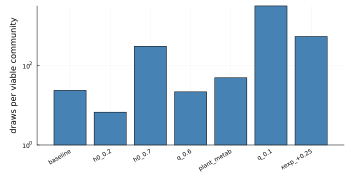
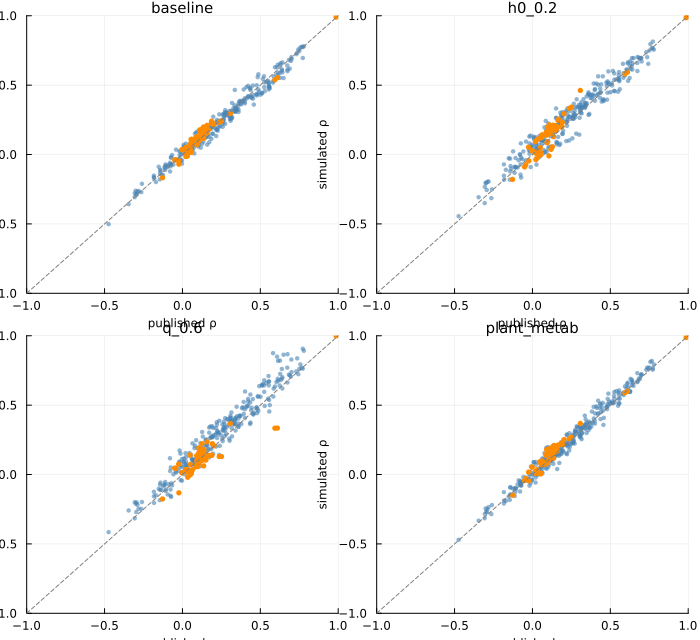
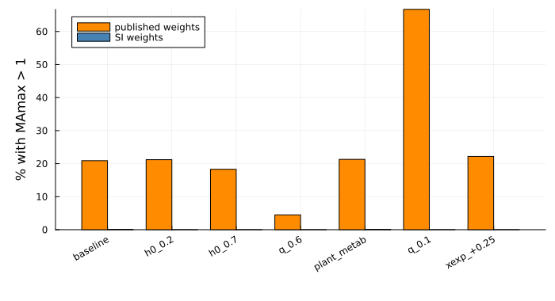

# Robustness of the reproduction to model settings
Simon Frost

- [Overview](#overview)
- [Some settings rarely give a viable
  community](#some-settings-rarely-give-a-viable-community)
- [The correlation structure](#the-correlation-structure)
- [Where the early-response metrics
  go](#where-the-early-response-metrics-go)
- [The early-response group follows the
  weights](#the-early-response-group-follows-the-weights)
- [Caveats](#caveats)
- [Data](#data)

## Overview

The reproduction of Domínguez-García et al. (2019) rests on a
reconstructed simulator. Its settings were calibrated to match summaries
of the published Dataset S1:

- half-saturation density h₀ = 0.4;
- functional-response exponent 1 + q with q = 0.3;
- no plant metabolism;
- metabolic exponent −0.25.

Two conclusions of the reproduction depend on this simulator:

- **the correlation structure:** simulated metric correlations reproduce
  the published three groups ([an end-to-end
  ensemble](../03_simulated_ensemble/03_simulated_ensemble.md));
- **the early-response artefact:** MR0, MAmax and Mtmax form a group
  only under the published, misaligned pulse weights ([the early
  response to pulse](../04_early_response/04_early_response.md)).

This vignette asks whether either conclusion changes when one setting
changes. Each variant uses the same community seeds as the baseline, so
differences between them are not due to drawing different webs.

| Variant | Setting changed | Calibrated value |
|----|----|----|
| `h0_0.2`, `h0_0.7` | half-saturation density h₀ = 0.2 or 0.7 | 0.4 |
| `q_0.6`, `q_0.1` | functional-response exponent 1 + q, q = 0.6 or 0.1 | 0.3 |
| `plant_metab` | plants pay metabolic costs | no |
| `xexp_+0.25` | metabolic exponent +0.25 | −0.25 |

``` julia
using DominguezGarcia2019
using CSV, DataFrames, Statistics, Printf
using Plots
using Random: Xoshiro

data = joinpath(pkgdir(DominguezGarcia2019), "data")
pub = read_metrics(joinpath(data, "dominguez-garcia2019", "Dataset_S2.csv"))

# the baseline: the first 1,200 seeds of the calibrated ensemble, the seeds every variant used
base = CSV.read(joinpath(data, "simulated", "ensemble_v4.csv"), DataFrame)
base = base[in.(base.network, Ref(Set("Sim$(20191217 + k)" for k in 1:1200))), :]
files = ["h0_0.2" => "h0_0.2", "h0_0.7" => "h0_0.7", "q_0.6" => "q_0.6",
         "plant_metab" => "plant_metabolism", "q_0.1" => "q_0.1",
         "xexp_+0.25" => "metabolic_exponent_+0.25"]
ensembles = ["baseline" => base;
             [name => CSV.read(joinpath(data, "simulated", "robustness", f * ".csv"), DataFrame)
              for (name, f) in files]]
ensembles = [name => d[5 .<= d.N .<= 99, :] for (name, d) in ensembles]
DataFrame(variant = first.(ensembles), communities = nrow.(last.(ensembles)))
```

<div><div style = "float: left;"><span>7×2 DataFrame</span></div><div style = "clear: both;"></div></div><div class = "data-frame" style = "overflow-x: scroll;">

| Row | variant     | communities |
|----:|:------------|------------:|
|     | String      |       Int64 |
|   1 | baseline    |        1165 |
|   2 | h0_0.2      |        1164 |
|   3 | h0_0.7      |          93 |
|   4 | q_0.6       |        1173 |
|   5 | plant_metab |        1158 |
|   6 | q_0.1       |           6 |
|   7 | xexp\_+0.25 |           9 |

</div>

## Some settings rarely give a viable community

A community is kept only if it reaches a locally stable equilibrium that
keeps at least 90% of its species. The number of assembly draws needed
per viable community measures how open a setting is to that rule. Three
variants (h₀ = 0.7, q = 0.1 and an exponent of +0.25) were stopped after
a 90-minute budget, which explains their small samples.

``` julia
viability = DataFrame(variant = first.(ensembles),
                      communities = nrow.(last.(ensembles)),
                      draws_per_community = [round(mean(d.attempts); digits = 1) for (_, d) in ensembles],
                      species_kept = [round(median(d.N ./ d.iniN); digits = 3) for (_, d) in ensembles],
                      plant_share = [round(median(d.Nb ./ d.N); digits = 3) for (_, d) in ensembles])
```

<div><div style = "float: left;"><span>7×5 DataFrame</span></div><div style = "clear: both;"></div></div><div class = "data-frame" style = "overflow-x: scroll;">

| Row | variant     | communities | draws_per_community | species_kept | plant_share |
|----:|:------------|------------:|--------------------:|-------------:|------------:|
|     | String      |       Int64 |             Float64 |      Float64 |     Float64 |
|   1 | baseline    |        1165 |                23.7 |        0.921 |       0.189 |
|   2 | h0_0.2      |        1164 |                 6.7 |        0.929 |       0.172 |
|   3 | h0_0.7      |          93 |               304.8 |        0.917 |       0.231 |
|   4 | q_0.6       |        1173 |                21.8 |        0.923 |       0.189 |
|   5 | plant_metab |        1158 |                49.5 |        0.917 |       0.202 |
|   6 | q_0.1       |           6 |              3171.7 |        0.896 |       0.298 |
|   7 | xexp\_+0.25 |           9 |               539.4 |        0.915 |       0.273 |

</div>

``` julia
bar(viability.variant, viability.draws_per_community; yscale = :log10, legend = false,
    ylabel = "draws per viable community", xrotation = 30, color = :steelblue,
    size = (700, 380), bottom_margin = 6Plots.mm, left_margin = 4Plots.mm)
```

<div id="fig-draws">



Figure 1: Assembly draws per viable community (log scale), on the same
1,200 seeds.

</div>

- **h₀ = 0.2 makes assembly easier:** about 7 draws per community,
  against 24 for the baseline.
- **Plant metabolism doubles the draws, and h₀ = 0.7 needs about 13
  times as many.**
- **q = 0.1 and an exponent of +0.25 almost never give a viable
  community:** thousands and hundreds of draws each, so only 6 and 9
  communities were reached in the budget. The paper’s assembly rule
  itself largely closes these parts of parameter space.

## The correlation structure

As in the comparison of structures across datasets, Spearman
correlations are computed within four richness bins (5–15, 16–30, 31–60
and 61–99 species) and averaged. The metric network is then partitioned
by Louvain modularity. A coarser binning than the paper’s size classes
is needed because each variant has at most 1,200 communities.

``` julia
const BINS = [(5, 15), (16, 30), (31, 60), (61, 99)]
const SIX = (:Amax, :tmax, :MRinf, :MR0, :MAmax, :Mtmax)   # the metrics with an SI version

function structure(m)
    b = [something(findfirst(r -> r[1] ≤ n ≤ r[2], BINS), 0) for n in m.N]
    m = m[b .> 0, :]
    m.N = b[b .> 0]
    sc = size_correlations(m; sizes = 1:length(BINS), max_sample = typemax(Int))
    k = length(sc.labels)
    R = [let v = filter(!isnan, sc.rho[i, j, :])
             isempty(v) ? NaN : mean(v)
         end for i in 1:k, j in 1:k]
    g, Q = modular_groups(metric_network(R); runs = 50, rng = Xoshiro(1))
    return (R = R, labels = sc.labels, groups = g, Q = Q)
end

# the metrics of one ensemble under the published or the SI's median-metric weights
function metrics(d, weights)
    d = copy(d)
    weights == "SI" && foreach(c -> (d[!, c] = d[!, Symbol(c, "_si")]), SIX)
    return prepare_metrics(d)
end

ref = structure(pub)
for k in 1:maximum(ref.groups)
    println("published group $k: ", join(ref.labels[ref.groups .== k], " "))
end
```

    published group 1: R0 Is Amax tmax Rinf MRinf S <s_ij> TM <TM> minTM <CE> TE maxCE
    published group 2: MR0 MAmax Mtmax
    published group 3: RM <RM> maxRM SM <SM> maxSM <RE> maxRE <SE> maxSE

Each simulated structure is compared with the published one and with the
baseline:

- **r(ρ):** the correlation between the 351 pairwise metric
  correlations;
- **mean \|Δρ\|:** their mean absolute difference;
- **Rand:** the agreement of the two partitions;
- **early:** whether MR0, MAmax and Mtmax fall in one group.

``` julia
upper(R) = [R[i, j] for j in axes(R, 2) for i in axes(R, 1) if i < j]
function agreement(a, b)
    x, y = upper(a.R), upper(b.R)
    ok = isfinite.(x) .& isfinite.(y)
    return cor(x[ok], y[ok]), mean(abs.(x[ok] .- y[ok]))
end
rand_index(a, b) = mean((a[i] == a[j]) == (b[i] == b[j]) for i in eachindex(a) for j in eachindex(a) if i < j)
early(s) = length(unique(s.groups[[findfirst(==(l), s.labels) for l in ("MR0", "MAmax", "Mtmax")]])) == 1

structures = Dict((name, w) => structure(metrics(d, w)) for (name, d) in ensembles, w in ("published", "SI"))
rows = map(Iterators.product(("published", "SI"), first.(ensembles))) do (w, name)
    s = structures[(name, w)]
    d = Dict(ensembles)[name]
    r, Δ = agreement(ref, s)
    rb, _ = agreement(structures[("baseline", w)], s)
    (variant = name, weights = w, amplify = round(100mean(d[!, w == "SI" ? :MAmax_si : :MAmax] .> 1 + 1e-12); digits = 1),
     r_published = round(r; digits = 2), mean_abs_diff = round(Δ; digits = 3),
     rand_published = round(rand_index(ref.groups, s.groups); digits = 2),
     r_baseline = round(rb; digits = 2), groups = maximum(s.groups), early = early(s))
end
table = DataFrame(vec(rows))
```

<div><div style = "float: left;"><span>14×9 DataFrame</span></div><div style = "clear: both;"></div></div><div class = "data-frame" style = "overflow-x: scroll;">

| Row | variant | weights | amplify | r_published | mean_abs_diff | rand_published | r_baseline | groups | early |
|---:|:---|:---|---:|---:|---:|---:|---:|---:|---:|
|  | String | String | Float64 | Float64 | Float64 | Float64 | Float64 | Int64 | Bool |
| 1 | baseline | published | 20.9 | 0.98 | 0.035 | 0.91 | 1.0 | 3 | true |
| 2 | baseline | SI | 0.1 | 0.9 | 0.071 | 0.97 | 1.0 | 3 | false |
| 3 | h0_0.2 | published | 21.2 | 0.97 | 0.053 | 1.0 | 0.97 | 3 | true |
| 4 | h0_0.2 | SI | 0.0 | 0.92 | 0.075 | 0.89 | 0.96 | 4 | false |
| 5 | h0_0.7 | published | 18.3 | 0.85 | 0.111 | 0.85 | 0.88 | 3 | true |
| 6 | h0_0.7 | SI | 0.0 | 0.8 | 0.129 | 0.96 | 0.86 | 4 | false |
| 7 | q_0.6 | published | 4.5 | 0.96 | 0.064 | 0.91 | 0.96 | 3 | true |
| 8 | q_0.6 | SI | 0.0 | 0.93 | 0.083 | 0.96 | 0.96 | 4 | false |
| 9 | plant_metab | published | 21.3 | 0.99 | 0.035 | 1.0 | 0.99 | 3 | true |
| 10 | plant_metab | SI | 0.1 | 0.91 | 0.07 | 0.97 | 0.99 | 3 | false |
| 11 | q_0.1 | published | 66.7 | 0.5 | 0.453 | 0.52 | 0.49 | 2 | true |
| 12 | q_0.1 | SI | 0.0 | 0.43 | 0.473 | 0.6 | 0.45 | 5 | false |
| 13 | xexp\_+0.25 | published | 22.2 | 0.58 | 0.388 | 0.5 | 0.55 | 2 | true |
| 14 | xexp\_+0.25 | SI | 0.0 | 0.57 | 0.402 | 0.55 | 0.55 | 4 | false |

</div>

`amplify` is the percentage of communities whose median pulse is
amplified (MAmax \> 1).

``` julia
early_metric = [l in ("MR0", "MAmax", "Mtmax") for l in ref.labels]
pair_early = [early_metric[i] || early_metric[j] for j in eachindex(ref.labels) for i in eachindex(ref.labels) if i < j]
panels = map(["baseline", "h0_0.2", "q_0.6", "plant_metab"]) do name
    y = upper(structures[(name, "published")].R)
    x = upper(ref.R)
    p = scatter(x[.!pair_early], y[.!pair_early]; ms = 2.5, msw = 0, alpha = 0.6, color = :steelblue,
                title = name, titlefontsize = 10, legend = false, xlims = (-1, 1), ylims = (-1, 1))
    scatter!(p, x[pair_early], y[pair_early]; ms = 3, msw = 0, color = :darkorange)
    plot!(p, [-1, 1], [-1, 1]; color = :gray, ls = :dash)
end
plot(panels...; layout = (2, 2), size = (700, 640), xlabel = "published ρ", ylabel = "simulated ρ",
     guidefontsize = 8)
```

<div id="fig-scatter">



Figure 2: Pairwise metric correlations in four well-sampled variants
against the published ones, under the published weights. Orange: pairs
involving MR0, MAmax or Mtmax.

</div>

- **Where a variant can be sampled, the structure holds.** h₀ = 0.2, q =
  0.6 and plant metabolism each give over 1,150 communities. Under the
  published weights they reproduce the published correlations about as
  well as the baseline does (r(ρ) 0.96–0.99, against 0.98). Each gives
  three groups close to the published ones (Rand 0.91–1.00).
- **They also agree with the baseline on the same seeds:** `r_baseline`
  is 0.96–0.99 under the published weights. Changing these settings
  moves the metrics, not their correlations.
- **h₀ = 0.7 (93 communities) still finds three groups**, with a weaker
  fit to the published correlations (r(ρ) 0.85, and 0.88 against the
  baseline), as expected from a twelfth of the sample.

## Where the early-response metrics go

For each partition, the table lists the metrics grouped with MAmax, and
says where MR0 sits: with MAmax, with the sensitivities to press (the
group holding RM), or elsewhere.

``` julia
members(s, l) = s.labels[s.groups .== s.groups[findfirst(==(l), s.labels)]]
function mr0_with(s)
    m = members(s, "MR0")
    "MAmax" in m && return "MAmax"
    "RM" in m && return "press sensitivities"
    return join(filter(!=("MR0"), m), " ")
end
DataFrame(variant = table.variant, weights = table.weights,
          with_MAmax = [join(filter(!=("MAmax"), members(structures[(r.variant, r.weights)], "MAmax")), " ")
                        for r in eachrow(table)],
          MR0_with = [mr0_with(structures[(r.variant, r.weights)]) for r in eachrow(table)])
```

<div><div style = "float: left;"><span>14×4 DataFrame</span></div><div style = "clear: both;"></div></div><div class = "data-frame" style = "overflow-x: scroll;">

| Row | variant | weights | with_MAmax | MR0_with |
|---:|:---|:---|:---|:---|
|  | String | String | String | String |
| 1 | baseline | published | R0 Amax MR0 Mtmax | MAmax |
| 2 | baseline | SI | Mtmax | press sensitivities |
| 3 | h0_0.2 | published | MR0 Mtmax | MAmax |
| 4 | h0_0.2 | SI |  | press sensitivities |
| 5 | h0_0.7 | published | R0 Amax MR0 Mtmax | MAmax |
| 6 | h0_0.7 | SI |  | press sensitivities |
| 7 | q_0.6 | published | R0 Amax MR0 Mtmax | MAmax |
| 8 | q_0.6 | SI |  | press sensitivities |
| 9 | plant_metab | published | MR0 Mtmax | MAmax |
| 10 | plant_metab | SI | Mtmax | press sensitivities |
| 11 | q_0.1 | published | R0 Is tmax MR0 Mtmax \<s_ij\> TM \<CE\> maxCE \<SM\> maxSM maxSE | MAmax |
| 12 | q_0.1 | SI |  | \<s_ij\> \<SM\> \<SE\> maxSE |
| 13 | xexp\_+0.25 | published | R0 Is Amax tmax MR0 Mtmax S \<s_ij\> \<CE\> RM maxRM SM maxSE | MAmax |
| 14 | xexp\_+0.25 | SI |  | press sensitivities |

</div>

- **Under the published weights MR0, MAmax and Mtmax share a group in
  every variant.** h₀ = 0.2 and plant metabolism give exactly the
  published partition. In the baseline, q = 0.6 and h₀ = 0.7, the
  extremal pulse metrics R0 and Amax join the group, much as in the
  large communities of the [early-response
  vignette](../04_early_response/04_early_response.md). With h₀ = 0.7,
  tmax also moves to the press group.
- **Under the SI’s weights the group breaks up the same way in every
  well-sampled variant.** MAmax and Mtmax are left alone or as a pair,
  and MR0 joins the sensitivities to press. With almost no amplified
  median pulse, MAmax and Mtmax are nearly constant across communities,
  so they correlate with nothing.

## The early-response group follows the weights

``` julia
pubw = table[table.weights .== "published", :]
siw = table[table.weights .== "SI", :]
x = 1:nrow(pubw)
bar(x .- 0.2, pubw.amplify; bar_width = 0.4, label = "published weights", color = :darkorange,
    xticks = (x, pubw.variant), ylabel = "% with MAmax > 1", xrotation = 30, size = (700, 380),
    bottom_margin = 6Plots.mm, left_margin = 4Plots.mm)
bar!(x .+ 0.2, siw.amplify; bar_width = 0.4, label = "SI weights", color = :steelblue)
```

<div id="fig-amplify">



Figure 3: Share of communities that amplify a median pulse, under the
published and the SI’s pulse weights.

</div>

- **In every variant the group forms under the published weights and not
  under the SI’s.** The SI’s weights leave 0–0.1% of communities
  amplifying a median pulse. This extends the [early-response
  artefact](../04_early_response/04_early_response.md) from the
  calibrated model to every setting tried.
- **Amplification depends on q; the group does not.** With q = 0.6 only
  4.5% of communities amplify under the published weights, against 21%
  in the baseline, yet the group still forms. The misaligned weights
  still make MAmax and Mtmax vary between communities.
- **The two barely sampled variants say little.** With q = 0.1 and an
  exponent of +0.25, 6 and 9 communities give partitions with two groups
  and correlations far from the published ones (r(ρ) 0.50 and 0.58).
  That MR0, MAmax and Mtmax share a group there is unsurprising when 27
  metrics are split in two, and is not evidence either way.

## Caveats

- **One setting at a time.** Interactions between settings are untested.
- **The SI rows are compared with a structure that contains the
  artefact.** Their lower r(ρ) against the published correlations is
  expected and is not a failure of the variant.
- **The binning is coarser than the paper’s.** Four richness bins
  replace the paper’s three size classes because the variants have 1,200
  communities, not 10,000.
- **Budgets, not convergence, set the small samples.** The h₀ = 0.7, q =
  0.1 and +0.25 runs were stopped after 90 minutes; their communities
  are those reached in that time, so their composition may differ from a
  full run’s.

## Data

The variant ensembles are in `data/simulated/robustness/` (see
`data/simulated/README.md`). They were simulated with
`scripts/simulate_dataset.jl` and the setting given as `KEY=VALUE`, and
the summary in this vignette can be printed with
`scripts/robustness.jl`.
